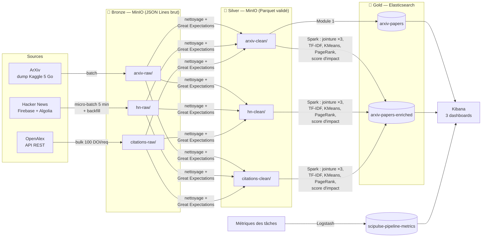

# SciPulse & SciPulse Insights

Plateforme de veille scientifique : ingestion, qualité, enrichissement et
exploration de **100 000 publications ArXiv** (informatique, 2015 → aujourd'hui),
croisées avec leur écho sur **Hacker News** et leurs **citations OpenAlex**.

Architecture Medallion (MinIO → Spark → Elasticsearch), orchestrée par Airflow,
validée par Great Expectations, visualisée dans Kibana.


---

## Sommaire

1. [Architecture](#architecture)
2. [Prérequis](#prérequis)
3. [Démarrage](#démarrage)
4. [Utilisation](#utilisation)
5. [Structure du dépôt](#structure-du-dépôt)
6. [Choix techniques](#choix-techniques)
7. [Qualité des données](#qualité-des-données)
8. [Score d'impact](#score-dimpact)
9. [Monitoring et alertes](#monitoring-et-alertes)
10. [Tests et CI](#tests-et-ci)
11. [Problèmes rencontrés et solutions](#problèmes-rencontrés-et-solutions)
12. [Documents complémentaires](#documents-complémentaires)

---

## Architecture



| Couche | Stockage | Contenu |
|---|---|---|
| 🥉 Bronze | MinIO `arxiv-raw/`, `hn-raw/`, `citations-raw/` | Données brutes, fidèles à la source, JSON Lines partitionné par date d'ingestion (`ingest_date=AAAA-MM-JJ/`) |
| 🥈 Silver | MinIO `arxiv-clean/`, `hn-clean/`, `citations-clean/` | Données nettoyées, dédupliquées, clés de jointure normalisées, validées par Great Expectations — Parquet |
| 🥇 Gold | Elasticsearch `arxiv-papers` (Module 1), `arxiv-papers-enriched` (Module 2) | Seule couche visible dans Kibana |

| Service | Rôle | URL | Identifiants |
|---|---|---|---|
| Airflow 2.10 | Orchestration (3 DAGs) | http://localhost:8080 | `admin` / `admin` |
| MinIO | Data lake S3 | http://localhost:9001 | `minioadmin` / `minioadmin` |
| Spark 3.5 | Master + 1 worker | http://localhost:8088 | — |
| Elasticsearch 8.13 | Serving Gold | http://localhost:9200 | — |
| Kibana 8.13 | Dashboards | http://localhost:5601 | — |
| Logstash 8.13 | Collecte des métriques | http://localhost:9600 | — |
| Data Docs GX | Rapports qualité | http://localhost:9000/gx-data-docs/index.html | — |

---

## Prérequis

- **Docker Desktop** (Compose v2) avec **≥ 10 Go de RAM** alloués.
  Sous Windows/WSL2, créer `%USERPROFILE%\.wslconfig` :
  ```ini
  [wsl2]
  memory=10GB
  swap=4GB
  ```
  puis `wsl --shutdown` et redémarrer Docker Desktop.
- **Python 3.11** (scripts hôte et tests).
- **GNU Make** (optionnel, Windows : `winget install ezwinports.make`).
- **~15 Go de disque** (images Docker + dump ArXiv).
- Une **clé API OpenAlex gratuite** (https://openalex.org/settings/api) — voir
  [Problèmes rencontrés](#problèmes-rencontrés-et-solutions).

## Démarrage

```bash
make up
```

Équivalent sans Make :

```bash
python scripts/init_env.py                 # crée .env depuis .env.example
docker compose up -d --build               # construit et démarre la stack
python scripts/check_stack.py --wait 600   # attend que tout soit sain
```

Le premier démarrage prend 15 à 20 minutes (construction des images Airflow,
Spark et MinIO). `check_stack.py` doit afficher **« Stack opérationnelle. »** :

```
OK  Elasticsearch          cluster yellow
OK  Kibana                 available
OK  Logstash               up
OK  MinIO                  up
OK  Airflow                {'metadatabase': 'healthy', 'scheduler': 'healthy'}
OK  Spark master           1 worker(s), 2 cœurs
OK  scipulse-airflow-init  exited (code 0)
OK  scipulse-minio-init    exited (code 0)
```

Renseigner ensuite dans `.env` : `OPENALEX_MAILTO` et `OPENALEX_API_KEY`, puis
`docker compose up -d` pour recharger.

Autres commandes : `make down` (arrêt), `make clean` (arrêt + suppression des
volumes), `make logs s=airflow-scheduler`, `make test`, `make lint`.

## Utilisation

Dans Airflow (http://localhost:8080) :

1. **`scipulse_hn_backfill`** — activer puis déclencher une fois (≈ 1 min) :
   historique des stories HN pointant vers arxiv.org.
2. **`scipulse_hn_poller`** — activer : snapshot HN toutes les 5 minutes.
3. **`scipulse_arxiv_pipeline`** — activer puis déclencher : pipeline complet
   (≈ 40 min, dont ≈ 25 min de Spark) :

```
ingest_arxiv_bronze → clean_arxiv_silver ─┬→ index_arxiv_gold                      (Module 1)
                                          └→ ingest_citations_bronze → clean_citations_silver ─┐
clean_hn_silver ───────────────────────────────────────────────────────────────────────────┤
                                                                  spark_gold_enrichment ←───┘
                                                                            ↓
                                                                     validate_gold
```

Les dashboards Kibana sont importés automatiquement (☰ → Dashboards) :
**Monitoring du pipeline**, **Exploration ArXiv**, **SciPulse Insights**.
Après une modification dans l'interface : `python scripts/kibana_objects.py export`.

Requêtes analytiques en ligne de commande :

```bash
docker exec scipulse-airflow-sched python -m scipulse.gold.validation
```

## Structure du dépôt

```
scipulse/
├── Makefile · docker-compose.yml · .env.example · pyproject.toml
├── docker/
│   ├── airflow/          image Airflow + Java + PySpark + GX (driver Spark)
│   ├── spark/            image Spark master/worker (Python 3.11)
│   ├── minio/            MinIO compilé depuis une release figée
│   ├── logstash/         pipeline de collecte des métriques
│   └── common/           JARs partagés (es-hadoop, hadoop-aws, graphframes)
├── airflow/dags/         3 DAGs (orchestration uniquement)
├── src/scipulse/
│   ├── config.py · storage.py · monitoring.py · http.py · alerts.py
│   ├── bronze/           arxiv.py · hn.py · openalex.py
│   ├── silver/           keys.py · arxiv.py · hn.py · citations.py · gate.py
│   ├── quality/          suites.py (expectations) · runner.py (GX 1.x)
│   └── gold/             es_index.py · spark.py · joins.py · text.py · graph.py
│                         scoring.py · spark_job.py · validation.py
├── gx/                   contexte Great Expectations (suites, checkpoints)
├── elasticsearch/        mappings versionnés (dynamic: strict)
├── kibana/               dashboards exportés (.ndjson)
├── notebooks/            01_analyse_qualite.ipynb
├── docs/                 spark_pipeline.md · validation.md · captures/
├── scripts/              init_env · init_buckets · check_stack · kibana_objects
└── tests/                pytest (moto pour S3, faux client HTTP)
```

Les DAGs ne contiennent **que l'orchestration** : toute la logique est dans
`src/scipulse`, testable sans Airflow.

---

## Choix techniques

### Infrastructure

| Choix | Justification |
|---|---|
| **Image Spark maison** (Python 3.11, Java 17, PySpark 3.5.4) | `apache/spark:3.5` embarque Python 3.8 alors que le driver (Airflow) est en 3.11 : PySpark refuse des versions mineures différentes entre driver et executors. |
| **Airflow = driver Spark** (mode client) | Le DAG lance `spark-submit` vers le master standalone ; l'image Airflow contient Java et les mêmes JARs que les workers. |
| **JARs pré-installés** dans les images | Pas de résolution Ivy au runtime : démarrage plus rapide, versions figées, fonctionne hors ligne. |
| **MinIO compilé depuis les sources** | Les images MinIO ne sont plus publiées publiquement (Docker Hub et quay.io exigent une authentification) : sans cela, `make up` échouerait sur une machine vierge. |
| **Healthchecks partout** + `depends_on: service_healthy` | Démarrage ordonné et fiable ; `check_stack.py` vérifie aussi qu'un worker Spark est attaché. |
| **Secrets dans `.env`** (ignoré par Git) | Aucun identifiant en dur dans le code ; identifiants de TP en local, clés internes Airflow (Fernet) générées aléatoirement. |
| **Logstash pour le monitoring** | Elasticsearch ne reçoit jamais de données Bronze/Silver (il ne sert que la couche Gold) ; Logstash indexe les métriques d'exécution écrites par les tâches. |
| **Sécurité ES désactivée** | Environnement local de TP ; en production : xpack.security, TLS, comptes de service. |

### Données

| Choix | Justification |
|---|---|
| **Échantillon de 100 000 articles** `cs.*` depuis 2015, **tirage aléatoire reproductible** (reservoir sampling, graine 42) | Le dump complet (2,7 M articles, 5 Go) dépasse une machine de 16 Go avec Spark + Elastic. Un tirage *uniforme* conserve les proportions entre années et catégories, contrairement aux N premières lignes (triées par ancienneté). |
| **Bronze = lignes inchangées** | La sélection porte sur les enregistrements, jamais sur leur contenu. Les réponses d'API sont enveloppées (`_source`, `_ingested_at`, `payload`) pour la traçabilité, sans modifier `payload`. |
| **Backfill HN via Algolia** | Le poller ne voit que les dernières heures ; sans historique, le recouvrement ArXiv × HN serait quasi nul. Algolia plafonnant à 1 000 résultats par recherche, la pagination se fait par **fenêtre temporelle glissante**. |
| **Snapshots HN** | Chaque poll ré-capture les stories encore en tête de liste : Silver garde le plus récent (score à jour). |
| **Parquet en Silver** | Format colonnaire compressé (≈ 2× plus léger que le JSON), lu nativement par Spark. |
| **Mappings ES `dynamic: strict`** + analyseur anglais | Types explicites ; un champ inattendu fait échouer l'indexation au lieu de polluer le mapping. Recherche plein texte avec racinisation (*networks* → *network*). |

### Source de citations : OpenAlex plutôt que Semantic Scholar

| Critère | OpenAlex | Semantic Scholar |
|---|---|---|
| Requêtes par lot | **100 DOI par requête** (filtre OR) → ~1 200 requêtes pour 100 000 articles | 500 ids par requête POST, mais quota sans clé très bas (partagé) |
| Vélocité de citation | **`counts_by_year`** natif | Non fourni directement |
| Graphe de citations (option B) | **`referenced_works`** inclus dans la même requête | Endpoint séparé, une requête par article |
| Champ disciplinaire | `primary_topic` (domaine / champ / sous-champ) | `fieldsOfStudy` |
| Impact normalisé | `fwci` | — |
| Licence | **CC0** | ODC-BY |

Correspondance : chaque article est recherché par son **DOI ArXiv**
(`10.48550/arxiv.<id>`) **et** par son DOI éditeur s'il existe. OpenAlex
fusionne souvent preprint et version publiée sous le DOI éditeur : interroger
les deux maximise le taux de correspondance.

### Spark

Détails, plans d'exécution et résultats : **[docs/spark_pipeline.md](docs/spark_pipeline.md)**.

- **Jointure à 3 sources** à la granularité « un article » : citations
  jointes via les deux DOI explosés en lignes (equi-join, pas de condition OR) ;
  HN agrégé par article *avant* jointure (pas de duplication).
- **Broadcast vs sort-merge** : comparés par `explain(mode="formatted")` et
  chronométrés ; l'agrégat HN (quelques milliers de lignes) est diffusé.
- **Window functions** : croissance annuelle par catégorie (`lag`),
  vélocité de citation, centiles (`percent_rank`) par cohorte d'année.
- **TF-IDF MLlib** (CountVectorizer pour garder le vocabulaire) → mots-clés.
- **Option C** : KMeans cosinus (k choisi par silhouette) + PCA 2D (`x_pca`, `y_pca`).
- **Option B** : GraphFrames, PageRank et composantes connexes sur le graphe de citations.
- **Écriture Gold** via **elasticsearch-hadoop** : seule écriture vers ES du Module 2.

---

## Qualité des données

Analyse détaillée : **[notebooks/01_analyse_qualite.ipynb](notebooks/01_analyse_qualite.ipynb)**.

| Source | Expectations | Exemples |
|---|---|---|
| ArXiv | 10 | id non nul, unique et au bon format ; titre non nul ; abstract de 50 à 10 000 caractères (`mostly=0.99`) ; année 1991 → année courante ; DOI ArXiv bien formé |
| Hacker News | 9 | id non nul et unique ; score et commentaires ≥ 0 ; source ∈ {firebase, algolia} ; id ArXiv au bon format |
| Citations | 5 | id OpenAlex non nul et unique ; DOI non nul et bien formé ; citations ≥ 0 |

**Porte qualité** (`silver/gate.py`) : on valide *avant* de publier. Si une
suite échoue, la partition Silver existante n'est pas écrasée, la métrique
passe en `quality_failed`, la tâche échoue, une alerte est émise et les
tâches Gold en aval sont bloquées.

Anomalies réelles corrigées en Silver : doublons de re-ingestion, textes
avec retours à la ligne, dates RFC 2822, **DOI multiples dans un même champ
ou échappés en LaTeX (`\_`)**, scores HN manquants, schémas HN hétérogènes
(Firebase vs Algolia).

## Score d'impact

```
impact = 100 × ( 0.45 · C  +  0.25 · H  +  0.15 · R  +  0.15 · P )
```

| Terme | Calcul | Pourquoi |
|---|---|---|
| **C** — citations | rang centile des citations **dans la cohorte de l'année de publication** | Les citations s'accumulent avec le temps : on compare un article à ses contemporains. Le centile est robuste à la loi de puissance des citations. |
| **H** — Hacker News | `log1p(points + commentaires) / log1p(max)` | Distribution très asymétrique : le log évite qu'une story à 3 000 points écrase tout le reste. |
| **R** — récence | `0.5 ^ (âge / 2 ans)` | Demi-vie de 2 ans : la veille privilégie le récent sans ignorer les classiques. |
| **P** — PageRank (option B) | rang centile du PageRank | Influence structurelle : être cité par des articles influents compte davantage. |

Pondérations : la veille scientifique privilégie l'**impact académique avéré**
(0,45), complété par l'**écho dans la communauté tech** (0,25), la
**fraîcheur** (0,15) et l'**influence structurelle** (0,15). Sans graphe
exploitable, le poids du PageRank est redistribué proportionnellement.

**Segments** (cas d'usage du dashboard Insights) :
- `academic_only` : top 10 % des citations de sa cohorte, jamais sur HN ;
- `viral_only` : top 25 % des articles sur HN, citations **connues** sous la
  médiane (un article absent d'OpenAlex n'est pas « peu cité » : ses
  citations sont inconnues — 100 faux positifs écartés par cette règle) ;
- `both` : top 25 % sur les deux axes.

## Monitoring et alertes

- Chaque tâche écrit une métrique (volume entrant/sortant/rejeté, durée,
  taux GX, fraîcheur des données, erreur) dans `data/metrics/*.jsonl` ;
  **Logstash** l'indexe dans `scipulse-pipeline-metrics`.
- Dashboard **Monitoring du pipeline** : volume par couche, taux de succès
  GX, fraîcheur par tâche, tableau des alertes.
- **Alertes** : `on_failure_callback` sur tous les DAGs → métrique
  `extra.alert = true` (visible dans Kibana) + webhook optionnel
  (`ALERT_WEBHOOK_URL` : Slack, Teams, Discord).

## Tests et CI

```bash
python -m pip install -r requirements-dev.txt
python -m pytest        # 60+ tests : S3 simulé (moto), API simulées, aucun réseau
python -m ruff check .
```

GitHub Actions (`.github/workflows/ci.yml`) à chaque push : ruff, pytest avec
couverture, validation de `docker-compose.yml`.

Workflow Git : développement sur la branche `dev`, fusion dans `main` par
pull request (validée par la CI) ; commits au format **Conventional Commits**.

---

## Problèmes rencontrés et solutions

| Problème | Solution |
|---|---|
| Images **MinIO** retirées des registres publics (`pull access denied`) | Image compilée depuis les sources à une release figée (`docker/minio/Dockerfile`). |
| **PySpark** : Python 3.8 (image officielle) ≠ 3.11 (Airflow) | Image Spark maison en Python 3.11. |
| Téléchargement du JAR AWS (280 Mo) **coupé en route** (curl code 18) | `curl --retry-all-errors`. |
| **Great Expectations 1.23** ne fournit plus de backend S3 pour les Data Docs | Génération locale puis copie dans MinIO par notre code (`quality/runner.py`). |
| GX crée son dossier *dans* `project_root_dir` (`gx/gx/`) | Passer la racine du dépôt comme `project_root_dir`. |
| **OpenAlex** : erreur 400 sur un lot de DOI | Cause : DOI multiples / échappés dans le dump ArXiv → nettoyage Silver ; et découpage dichotomique du lot pour isoler un DOI refusé. |
| **OpenAlex** : quota sans clé de 0,10 $/jour partagé par IP (~1 000 requêtes) | Clé gratuite (1 $/jour) + 100 DOI par requête. |
| Spark ne lit pas les horodatages **nanosecondes** écrits par pandas | `coerce_timestamps="us"` à l'écriture Parquet. |
| Spark : `aggregate` refuse un accumulateur `int` sur des `long` | Accumulateur typé `long`. |
| Windows : fins de ligne CRLF dans les scripts shell des images | `.gitattributes` (`eol=lf`) + `sed` défensif dans les Dockerfiles. |

## Documents complémentaires

- [docs/spark_pipeline.md](docs/spark_pipeline.md) — pipeline Spark, jointures, score, options B et C
- [docs/validation.md](docs/validation.md) — procédure de validation sur jeu de test, captures
- [notebooks/01_analyse_qualite.ipynb](notebooks/01_analyse_qualite.ipynb) — analyse qualité et statistiques descriptives
- [docs/captures/](docs/captures/) — captures d'écran
